

# Compte rendu final · Cartographie et localisation avec un lidar LD06

Module « Cartographie et localisation appliquée à la robotique mobile » · EIGSI · prof. Jonathan Quillès 
TP des 02, 03 et 04/11/2026

**Dépôt :** https://github.com/Togola2003/INIT-LIDAR-MAPPING · **Version validée en salle :** tag [`jour3`](https://github.com/Togola2003/INIT-LIDAR-MAPPING/tree/jour3)

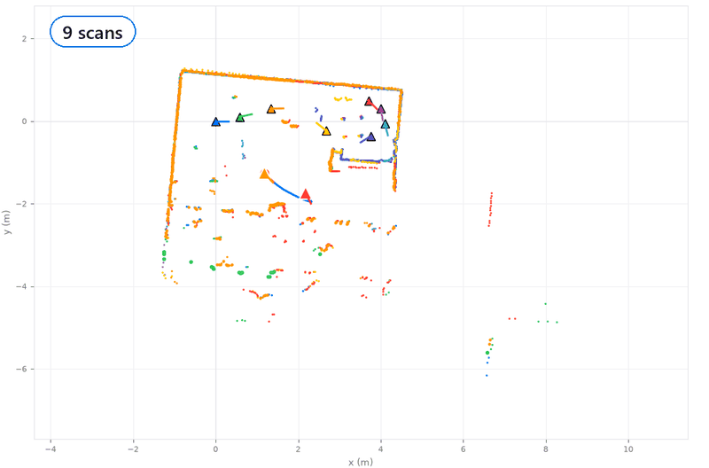

## 1. En cinq lignes

1. Le robot Mecanum (ESP32) envoie ses tours de lidar en Wi-Fi. **Tout le calcul est fait en Python** sur le PC.
2. **Jour 1 :** lecture du LD06, nuages de points, grid map et carte vectorielle, sur 16 scans pris à la main.
3. **Jour 2 :** localisation sur une carte connue. 10 méthodes comparées sur 6 240 essais ; la meilleure réussit à 99 %.
4. **Jour 3 :** **SLAM pas à pas** sur le vrai robot. 93 scans, la salle entière, chaque scan localisé en 15 à 35 ms.
5. Le tout est réuni dans **LidarLab**, une application en 6 étapes que nous avons construite.

## 2. L'énoncé, et où trouver chaque réponse

| Attendu | Fait | Où |
|---|---|---|
| Afficher les données du lidar en nuages de points | ✅ | LidarLab, [Jour 1 §2](TP/Jour1/COMPTE_RENDU.md) |
| Construire une grid map | ✅ log-odds, Bresenham, réglages impact / traversée | `src/lidar/gridmap.py`, [Jour 1](TP/Jour1/COMPTE_RENDU.md) |
| Points → segments → carte vectorielle | ✅ split-and-merge, ACP, fusion | `segments.py`, `vectormap.py` |
| Localisation sur grid map, carte vectorielle, scan de référence | ✅ 10 méthodes, banc d'essai chiffré | [Jour 2](TP/Jour2/COMPTE_RENDU.md) |
| SLAM et carte complète de la salle | ✅ 93 scans le 04/11 | [Jour 3](TP/Jour3/README.md), [docs/SLAM.md](docs/SLAM.md) |
| Bonus : déplacer le robot et cartographier en temps réel | ✅ pilotage Wi-Fi, suivi en direct entre deux scans | `app/live.py`, `firmware/02_LidarRobot_WiFi` |
| Utiliser git | ✅ ≈ 60 commits, un par étape, tags `jour1` `jour2` `jour3` | [JOURNAL.md](JOURNAL.md), `git log` |

## 3. Notre façon de travailler

- **Simulation d'abord.** Chaque algorithme est essayé dans une salle virtuelle où la vraie pose est connue
  (`simulate.py`). On sait donc si une erreur vient de l'algorithme ou de la mesure.
- **Une méthode, puis ses limites, puis mieux.** C'est la démarche du cours. Exemple du Jour 2 : gradient seul
  (coincé), puis exhaustive (lente), puis multi-résolution, puis la combinaison des deux.
- **Des tests pour tout.** 134 tests `pytest`, dont un tour complet de salle simulée en SLAM (18 scans, chaque pose
  à ≤ 1 cm).
- **Un commit par étape, un tag par journée.** Le [journal](JOURNAL.md) relie chaque étape à son commit, avec les
  problèmes rencontrés.
- **Tout est rejouable.** Les mesures brutes sont dans `data/`. Les figures des Jours 1 et 2 se régénèrent avec
  `TP/JourN/*.py`.

## 4. Les trois journées

### Jour 1 · Lire le lidar et cartographier

- **Comprendre le capteur :** 8 leçons (`lecons/`), de la trame de 47 octets jusqu'au tour complet et au changement
  de repère.
- **Mesurer :** 16 scans en salle, poses mesurées à la main (±10 cm, ±5°).
- **Corriger :** ICP, puis recalage **global** de toutes les poses ensemble : écart entre scans 6,4 → 2,2 cm.
- **Cartes :** grid map à 5 cm, puis segments et murs.

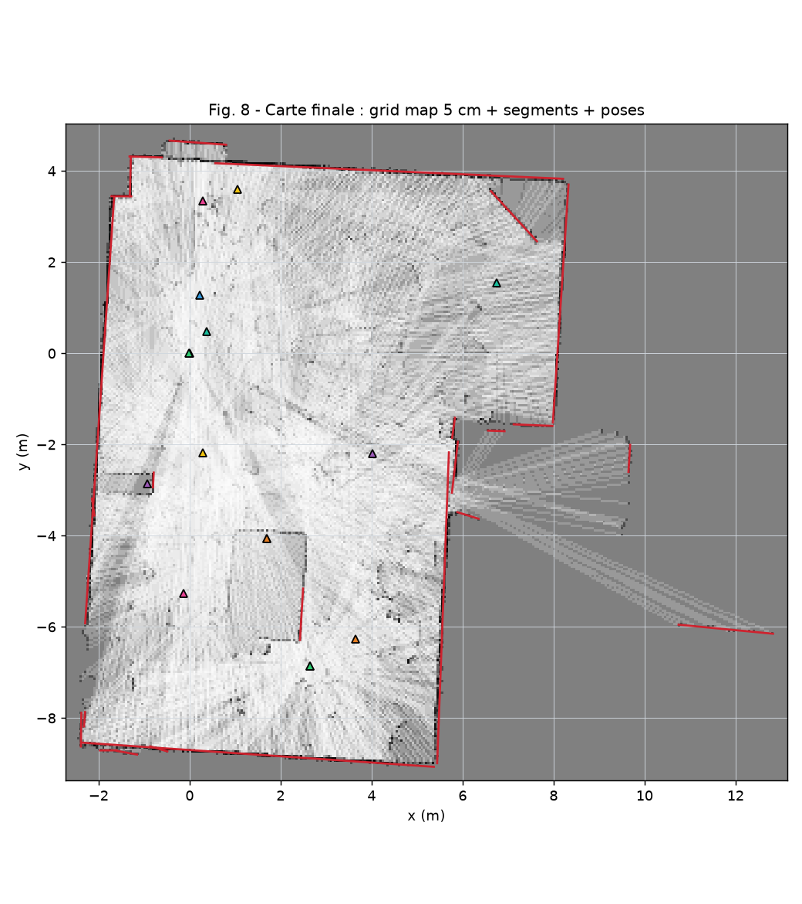

*Carte du Jour 1 : poses à la main, seule une partie de la salle est couverte.*

### Jour 2 · Se localiser sur une carte connue

- **Banc d'essai :** chaque scan est localisé sur une carte faite **sans lui**, en partant d'une pose volontairement
  fausse (10 cm / 5° jusqu'à 1 m / 30°). 6 240 essais.
- **Résultat :** multi-résolution puis gradient, **99 %** de réussite sur les zones couvertes par la carte, environ
  10 ms par localisation.
- **Dans l'application :** localisation **globale** (sans pose de départ) et **suivi en direct** du robot.

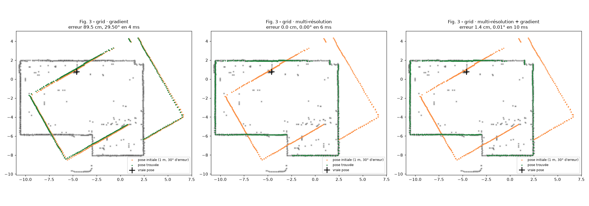

*Le gradient seul s'arrête sur le mauvais mur (89 cm d'erreur) ; en partant du grossier, on tombe juste.*

### Jour 3 · SLAM pas à pas, sur le vrai robot

La consigne :
1. le 1er scan est la référence ;
2. on déplace un peu le robot et on rescanne ;
3. le scan se localise grâce à ses **points communs** avec la référence ;
4. sa **partie nouvelle** s'ajoute, ce qui donne la nouvelle référence.

**Notre calcul pour chaque scan** (`src/lidar/slam.py`) :
1. **pose grossière :** recherche sur la grid map, du grossier au fin, à ± 1 m et ± 40° de la pose prévue ;
2. **pose fine :** ICP sur les points de la carte, gardé seulement s'il améliore l'accord ;
3. **commun / nouveau :** un point à moins de 8 cm de la carte est commun ;
4. **boucle :** quand le robot revoit un scan ancien, « Optimiser » corrige toutes les poses ensemble.

| Mesure en salle (04/11, 13 h 09 → 14 h 07) | Valeur |
|---|---|
| Scans gardés | **93**, toute la salle (≈ 12 × 9 m, 107 m² vus) |
| Points communs par scan (aperçus capturés) | 89 à 94 % |
| Temps de localisation d'un scan | 15 à 35 ms |
| Bruit des scans (11 tours combinés à l'arrêt) | 1 à 2 cm |

**Question du prof : la grid map est-elle faite une fois à la fin, ou scan par scan ?**
- **Scan par scan.** Chaque faisceau baisse la probabilité des cases qu'il **traverse** et monte celle de la case
  d'**impact**.
- **Ce que ça donne :** un mur vu par plusieurs scans devient plus sûr, et un objet qui a bougé s'efface.
- **L'ordre ne compte pas :** c'est une somme, donc « à la fin » et « au fur et à mesure » donnent la même carte.
  C'est vérifié dans `tests/test_gridmap.py`.
- Explication complète : [docs/SLAM.md](docs/SLAM.md).

## 5. Ce qui n'a pas marché, puis a marché

| Problème | Cause trouvée | Solution |
|---|---|---|
| Carte du Jour 1 en miroir | la bibliothèque LD06 calcule `y = −d·sin θ` | corrigé au décodage |
| Intensité absente des 1ers scans | le format Teleplot n'envoie que x et y | passage au format CSV au Jour 2 |
| ICP lent (13,7 s) | recherche du point le plus proche « à la main » | arbre k-d : 0,17 s |
| Les erreurs de pose s'accumulent | chaque scan est recalé sur le précédent | recalage **global** de toutes les poses |
| Le gradient échoue à 50 cm d'erreur | **minimum local** : il suit la pente vers le mauvais mur | multi-résolution d'abord : 99 % |
| « Localiser » posait le scan à côté de la carte | départ trop loin (5 à 10 m) pour une recherche à ± 1 m | localisation **globale**, sans pose de départ |
| Les moteurs tournent seuls | broches flottantes au démarrage, D19 utilisée par l'I2C | firmware à nous : 8 broches à 0 dès `setup()` |
| Rotation inversée | relevé des roues fait robot vu de face | gauche et droite échangés dans `moteurs.h` |
| Le suivi en direct saute à travers la salle | tour flou pendant un virage, cherché sans a priori | pose prévue par les commandes (odométrie), tours douteux ignorés |
| Le suivi se fige au bout d'un moment | Tk n'accepte qu'un seul fil ; une police était libérée depuis le fil de calcul | polices partagées, ramasse-miettes lancé par l'interface |
| « Boucle refermée » annoncée trop tôt | un scan voisin compté comme « ancien » | boucle seulement après 3 m de trajet |

## 6. Ce que nous avons compris

- **Une carte ne rétrécit pas.** Le lidar mesure en mètres : poser un scan, c'est le tourner et le déplacer, jamais
  l'étirer. Le seul risque est un scan **mal posé**, d'où les points communs affichés.
- **Grid map ou vectoriel :** la grid map accepte n'importe quel nouveau scan (chaises, pieds de table compris), donc
  le SLAM se fait dessus. La carte vectorielle est plus précise sur les murs droits, et sert de plan final.
- **Du grossier au fin :** une recherche locale (gradient, ICP) est précise mais aveugle. Il lui faut un bon départ.
- **Les petits pas sont la clé du SLAM :** beaucoup de points communs, donc une pose sûre.
- **Le matériel compte autant que l'algorithme :** câblage, broches au démarrage, débit série, serveur web
  mono-tâche du robot.

## 7. Nos « plus », non demandés

| | |
|---|---|
| 🖥️ **LidarLab** | une application unique en 6 étapes, style clair, Ctrl+Z partout, projet enregistrable |
| 📶 **Firmware Wi-Fi à nous** | lidar + 4 roues + télécommande sur téléphone (http://192.168.4.1), compatible avec le protocole RobotControl |
| 🎯 **Localisation globale** | retrouver le robot sans pose de départ (idée de l'appli *ld06-slam* d'un camarade, réécrite en Python) |
| 🔴 **Suivi en direct** | le robot est suivi entre deux scans, dans un fil de calcul à part, avec une odométrie tirée des commandes |
| 🟠🟢 **Aperçu commun / nouveau** | avant de garder un scan, on voit ce qu'il partage avec la carte et ce qu'il ajoute |
| ✏️ **Retouches** | tracer, prolonger, effacer un mur : appliqué à la grid map **et** à la carte vectorielle |
| 📄 **Format `.lidar.json`** | fichier auto-décrit : unités, repères et poses écrits dedans |
| 🧪 **Banc d'essai et simulation** | 6 240 localisations chiffrées, salle virtuelle à vérité connue |
| 📚 **Leçons** | le LD06 expliqué octet par octet, un script par leçon |

## 8. Galerie de l'essai du 04/11

| | |
|---|---|
| 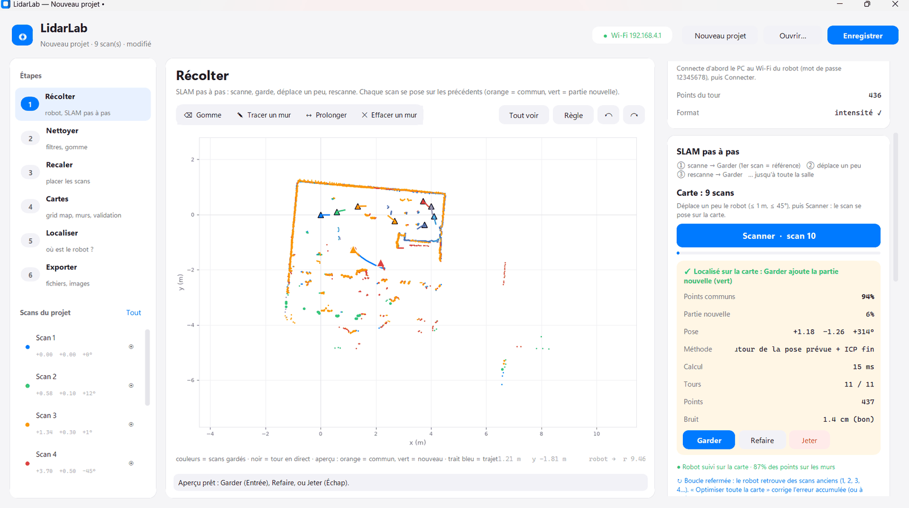 | 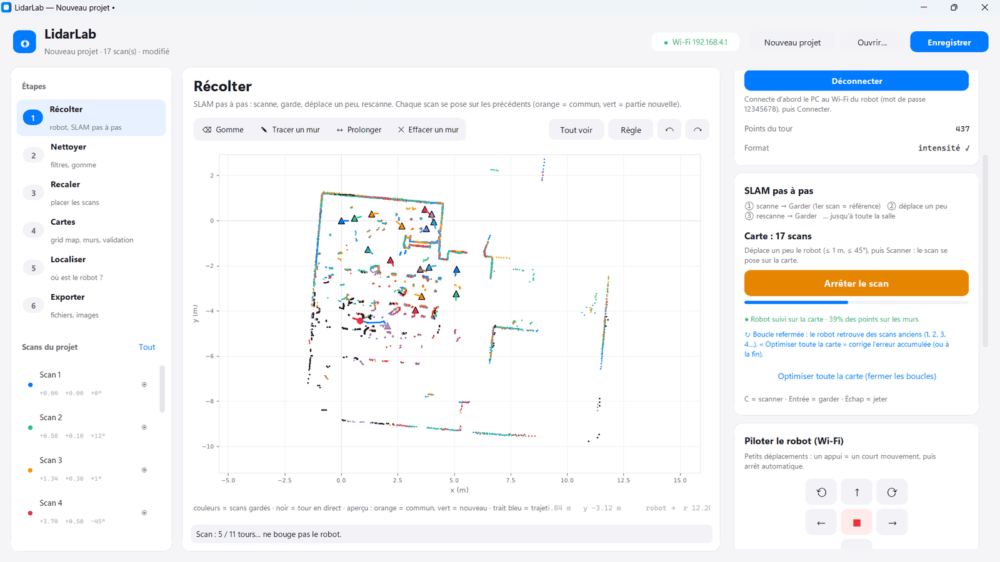 |
| **9 scans** · aperçu : 94 % de points communs, partie nouvelle en vert | **17 scans** · scan en cours (11 tours à l'arrêt), robot suivi en direct |
| 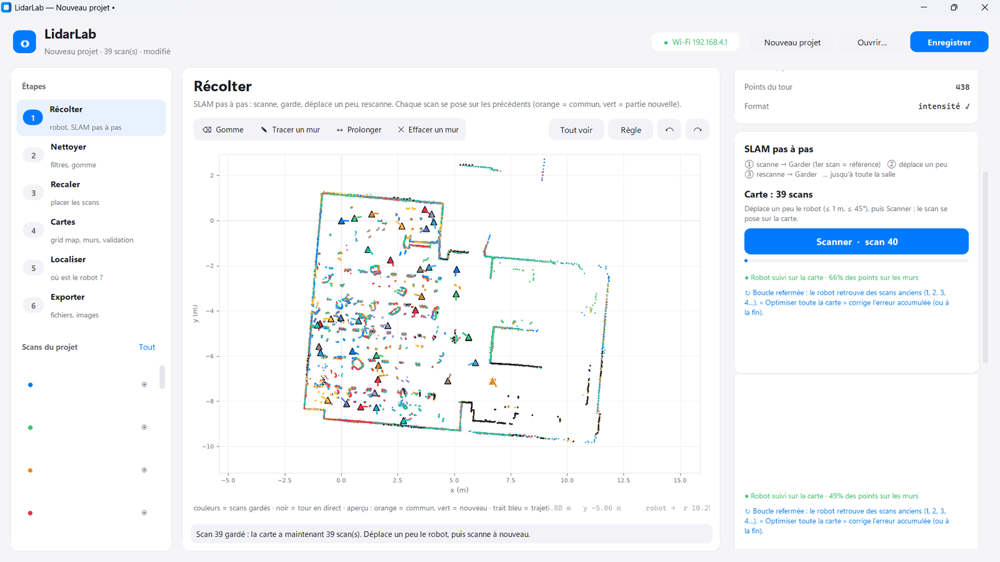 | 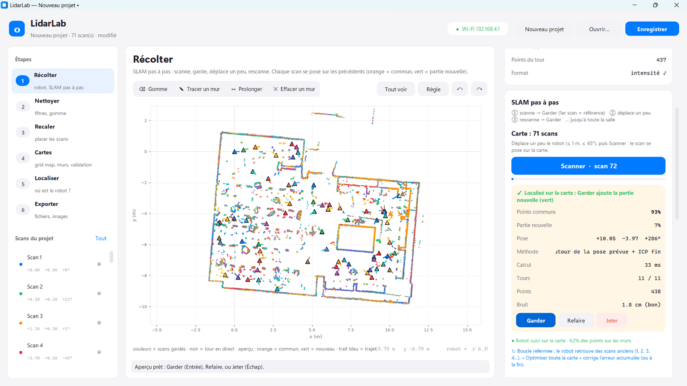 |
| **39 scans** · on passe dans la 2e moitié de la salle | **71 scans** · les murs se referment |
| 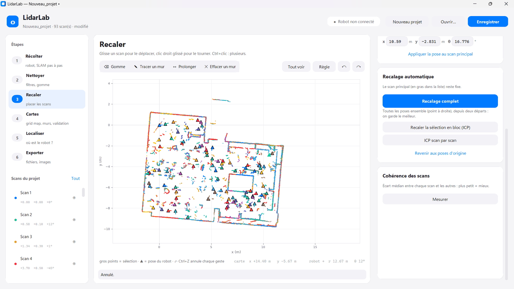 | 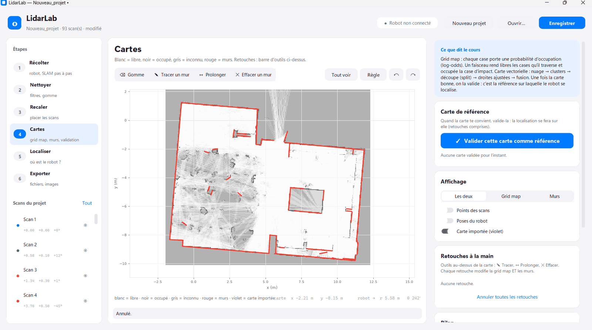 |
| **93 scans** · la salle complète, étape Recaler | **Cartes** · grid map et murs extraits (rouge) |
| 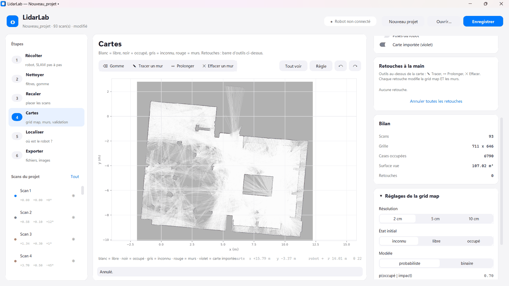 | 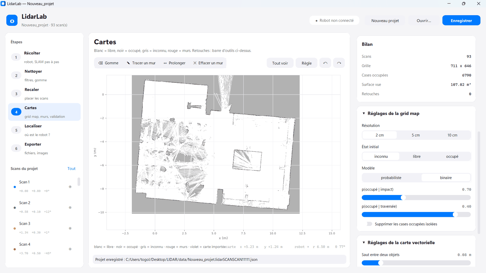 |
| **Bilan** · 93 scans, 107 m² vus, réglages de la grid map | **Modèle binaire** · les curseurs impact / traversée changent ce qui reste |

Toutes les captures : [`docs/images/jour3/`](docs/images/jour3/). Session complète, à rouvrir dans LidarLab :
[`data/salle_jour3/slam_salle_04-11.lidar.json`](data/salle_jour3/slam_salle_04-11.lidar.json).

## 9. Limites et suites possibles

- **Pas de codeurs sur les roues :** l'odométrie vient des commandes envoyées, donc elle est approximative. Mesurer la
  vitesse réelle (m/s et °/s) l'améliorerait.
- **Stop and go :** on scanne à l'arrêt (11 tours combinés). Cartographier en roulant demanderait de corriger la
  déformation d'un tour pris en mouvement.
- **Méthode probabiliste** (filtre particulaire) : non faite, facultative.

## 10. Conclusion personnelle

→ [TP/CONCLUSION.md](TP/CONCLUSION.md)
