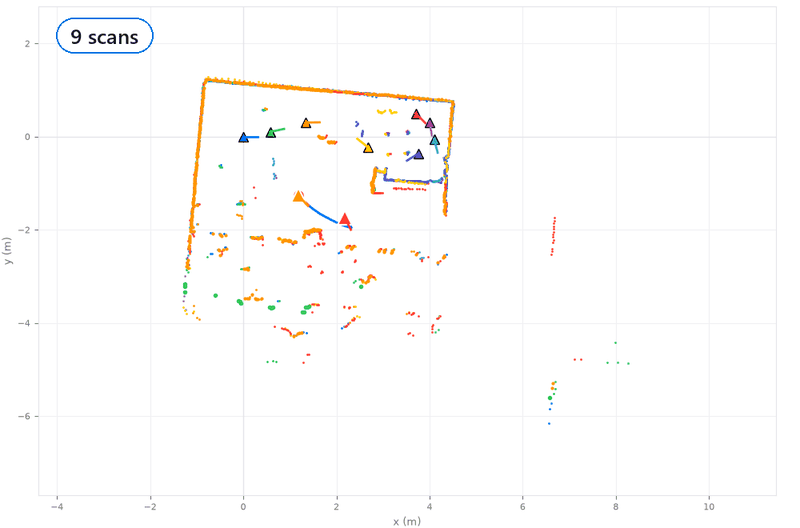
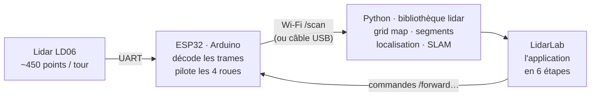
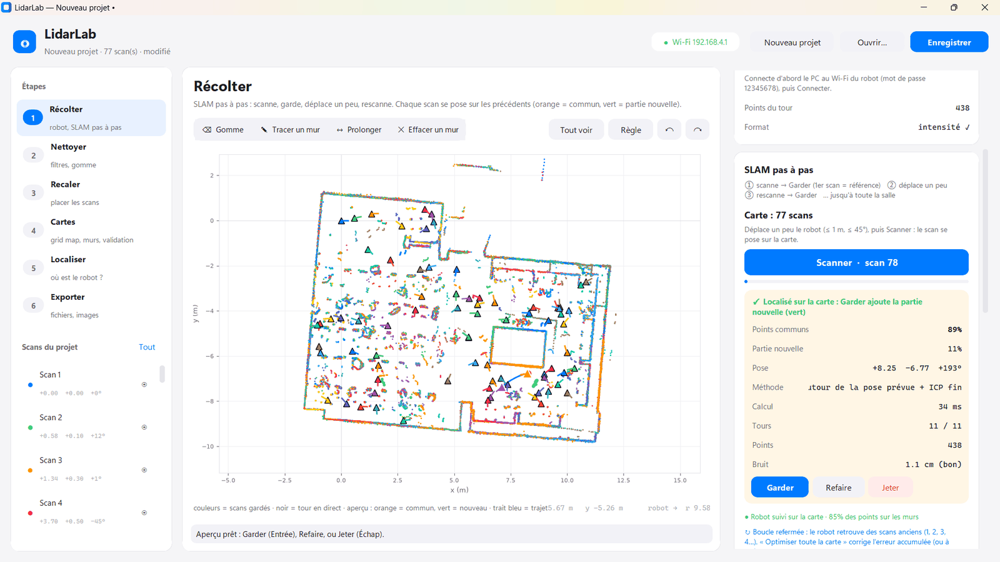
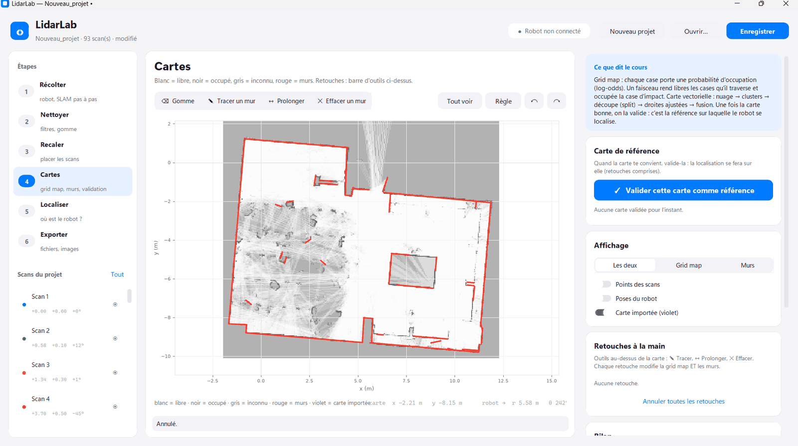
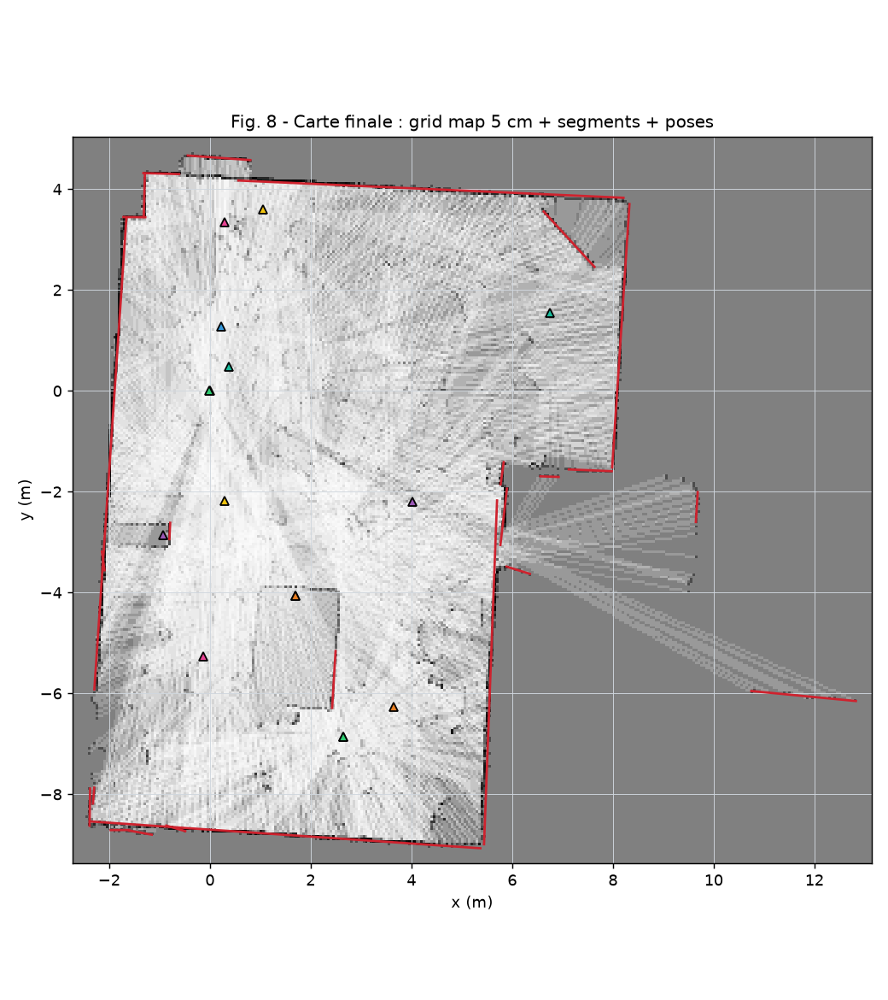
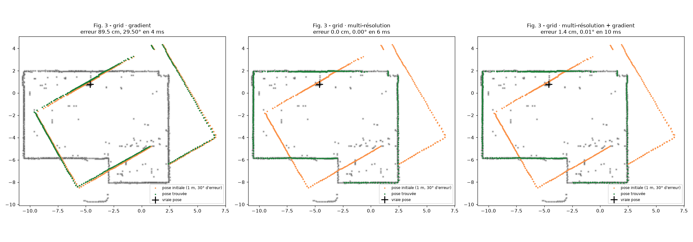
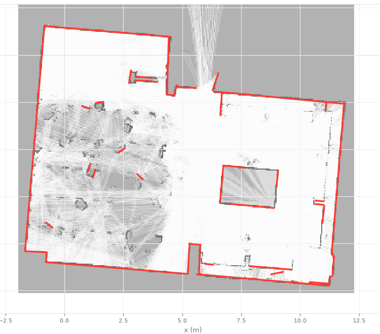
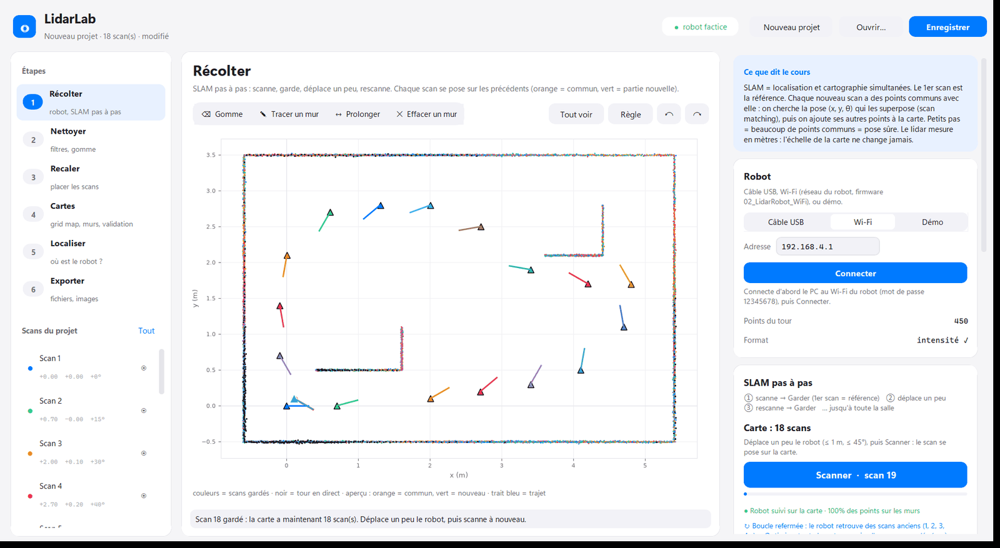
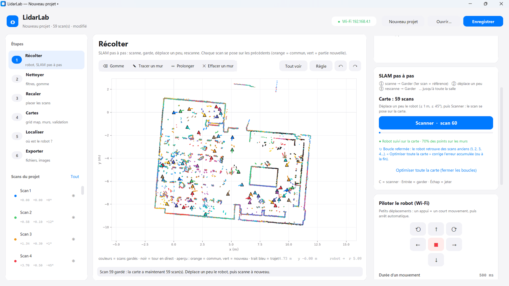

<div align="center">

# LidarLab

**Cartographie et localisation d'un robot mobile avec un lidar LD06**

Un robot Mecanum (ESP32), un lidar 360°, une salle de classe :
la carte complète construite **scan après scan**, et le robot qui s'y retrouve tout seul.




<sub>Essai réel du 04/11/2026 : 93 scans, la salle entière (≈ 12 × 9 m), puis la grid map et les murs.</sub>

**[Compte rendu final](COMPTE_RENDU.md)** · [Conclusion personnelle](TP/CONCLUSION.md) · [Journal de bord](JOURNAL.md) · [Le SLAM expliqué](docs/SLAM.md) · [Mode d'emploi](docs/OUTILS.md) · [Robot et firmware](firmware/README.md)

</div>

---

## En bref

| | |
|---|---|
| 🎯 **Le but** | Module « Cartographie et localisation appliquée à la robotique mobile » (EIGSI, prof. J. Quillès) : cartographier la salle avec le lidar, puis y localiser le robot |
| 🗺️ **Le résultat** | Carte complète de la salle par **SLAM pas à pas** : 93 scans, chaque scan localisé en 15 à 35 ms et posé sur les précédents |
| 🧠 **Le calcul** | Tout en **Python**, sur le PC. Le robot se contente d'envoyer ses points en Wi-Fi |
| ✅ **La rigueur** | 134 tests, simulation à vérité connue avant chaque essai réel, un commit par étape, un tag par journée |

## Comment ça marche



### ① Récupérer les points : le robot (Arduino, C++)

- Le **LD06** envoie des trames de 47 octets (12 mesures chacune). L'**ESP32** les décode et les regroupe en tours
  complets de 360°.
- **Jour 1 :** les scans partent en texte sur le câble USB (`firmware/ESP32_LD06_CSV`).
- **Jour 3 :** firmware complet `firmware/02_LidarRobot_WiFi`. Il crée son propre réseau Wi-Fi (`LD06-Togola`), sert
  le dernier tour sur `/scan`, obéit aux commandes de déplacement et affiche une **télécommande sur le téléphone**.
- Avant cela, il a fallu comprendre le câblage : pourquoi **les moteurs tournaient tout seuls**, et quel fil commande
  quelle roue ([firmware/README.md](firmware/README.md)).

### ② Les algorithmes : la bibliothèque Python `src/lidar/`

| Module | Ce qu'il fait |
|---|---|
| `scan.py`, `acquire.py` | décodage des trames LD06, repères, filtres (distance, intensité, points isolés) |
| `gridmap.py` | grille d'occupation en **log-odds** : faisceau tracé (Bresenham), cases traversées → libres, impact → occupé |
| `segments.py`, `vectormap.py` | carte vectorielle : clusters → découpe *split-and-merge* → droites ajustées (ACP) → fusion des murs |
| `matching.py` | **ICP** (point à point, point à droite) et **recalage global** de toutes les poses ensemble |
| `localization/` | 10 méthodes de localisation (grid, vectoriel, entre scans), globale et en temps réel |
| `slam.py` | le **SLAM pas à pas** : pose grossière sur la grid map, puis ICP fin, points communs / nouveaux, boucles |
| `simulate.py` | une salle virtuelle à **vérité connue**, pour tester chaque algorithme avant la vraie salle |

### ③ Ce qu'on a construit autour : l'application LidarLab

Une seule fenêtre, six étapes, dans l'ordre du cours. Chaque geste s'annule (Ctrl+Z).

| Étape | Ce qu'on y fait |
|---|---|
| **1 · Récolter** | piloter le robot, **scanner → aperçu (orange = commun, vert = nouveau) → Garder** |
| **2 · Nettoyer** | filtres et gomme |
| **3 · Recaler** | déplacer un scan à la souris, ICP, recalage complet |
| **4 · Cartes** | grid map et murs, curseurs impact / traversée, retouches, carte de référence |
| **5 · Localiser** | un scan libre revient se poser sur la carte, ou le robot est suivi en direct |
| **6 · Exporter** | images, fichiers, projet `.lidar.json` |

<table>
<tr>
<td width="50%"></td>
<td width="50%"></td>
</tr>
<tr>
<td align="center"><sub><b>Récolter</b> · scan 78 localisé : 89 % de points communs, 34 ms</sub></td>
<td align="center"><sub><b>Cartes</b> · la grid map et les murs (en rouge)</sub></td>
</tr>
</table>

## Le parcours en trois jours

| | Jour 1 · Cartographier | Jour 2 · Se localiser | Jour 3 · SLAM |
|---|---|---|---|
| **Question** | Lire le lidar, faire une grid map et une carte vectorielle | Retrouver la pose du robot sur une carte connue | Construire la carte **et** se localiser, en même temps |
| **Réponse** | 16 scans, poses mesurées à la main puis corrigées (ICP, recalage global : 6,4 → 2,2 cm) | 10 méthodes, 6 240 essais : multi-résolution + gradient, **99 %** de réussite | Robot en Wi-Fi, chaque scan posé sur la carte en construction : **93 scans, salle complète** |
| **Image** |  |  |  |
| **Détails** | [Compte rendu](TP/Jour1/COMPTE_RENDU.md) | [Compte rendu](TP/Jour2/COMPTE_RENDU.md) | [Jour 3](TP/Jour3/README.md) · [SLAM](docs/SLAM.md) |

**Simulation d'abord, salle ensuite.** Chaque algorithme est d'abord essayé dans une salle virtuelle où l'on connaît
la vraie position du robot. Le SLAM y retrouve chaque pose à **1 cm près**. Ensuite seulement, on passe au vrai robot.

<table>
<tr>
<td width="50%"></td>
<td width="50%"></td>
</tr>
<tr>
<td align="center"><sub><b>Simulation</b> · 18 scans, chaque pose à ≤ 1 cm</sub></td>
<td align="center"><sub><b>Salle réelle</b> · 59 scans, la 2e moitié de la salle se dessine</sub></td>
</tr>
</table>

## Ce qui a résisté

| Problème | Ce qu'on a compris | Solution |
|---|---|---|
| La localisation par gradient échoue dès 50 cm d'erreur | elle s'arrête sur un **minimum local** (le mauvais mur) | recherche du grossier au fin, puis gradient : 0 % → 99 % |
| Les moteurs tournent seuls | broches de l'ESP32 qui **flottent** au démarrage, D19 prise par l'I2C | les 8 broches mises à 0 dès la 1re ligne de `setup()` |
| « Tourner à gauche » tourne à droite | relevé des roues fait **robot vu de face** | gauche et droite échangés dans `moteurs.h` |
| Le suivi en direct se fige | une police Tk libérée **depuis le mauvais fil** | polices partagées, ramasse-miettes lancé par l'interface |
| L'erreur s'accumule de scan en scan | chaque pose dépend de la précédente | **optimisation globale** de toutes les poses (fermeture de boucle) |

Tout le détail, avec les commits : [JOURNAL.md](JOURNAL.md).

## Démarrer

```powershell
python -m venv .venv
.venv\Scripts\Activate.ps1
pip install -e .
pip install pytest
python -m pytest          # 134 tests
```

Puis double-clic sur **`LidarLab.bat`**. Le bouton **Démo** permet d'essayer sans robot. Pour revoir la session réelle,
ouvre **Ouvrir… → `data/salle_jour3/slam_salle_04-11.lidar.json`**.

## Le dépôt

```
── Partie A : les outils ─────────────────────────────────────────────
src/lidar/          bibliothèque Python (algorithmes)
src/lidar/app/      LidarLab, l'application unique
firmware/           programmes ESP32 (Arduino)
tests/              134 tests (dont un tour de salle simulé complet)
lecons/             initiation au LD06, octet par octet
docs/               le SLAM expliqué, mode d'emploi, images

── Partie B : la réalisation du TP ───────────────────────────────────
COMPTE_RENDU.md     compte rendu final
TP/CONCLUSION.md    conclusion personnelle
TP/                 comptes rendus du Jour 1, 2 et 3, figures, conclusion
data/               mesures réelles (salle, salle_jour2, salle_jour3) et simulées
JOURNAL.md          traçabilité : quoi, quand, quel commit
```

## Versions

Chaque journée validée est marquée par un **tag git** : `jour1`, `jour2`, `jour3`. Le tag **`jour3`** est la version
qui a fonctionné en salle le 04/11. Pour y revenir :
- **sur GitHub :** bouton des branches → onglet **Tags** → `jour3` (ou « Download ZIP ») ;
- **en local :** `git checkout jour3`, puis `git checkout main` pour revenir.

<sub>Les supports de cours (`RESSOURCES/`, PDF) restent en local et ne sont pas versionnés.</sub>
