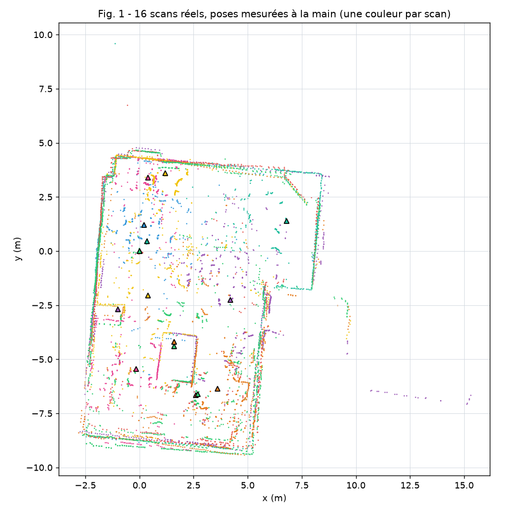
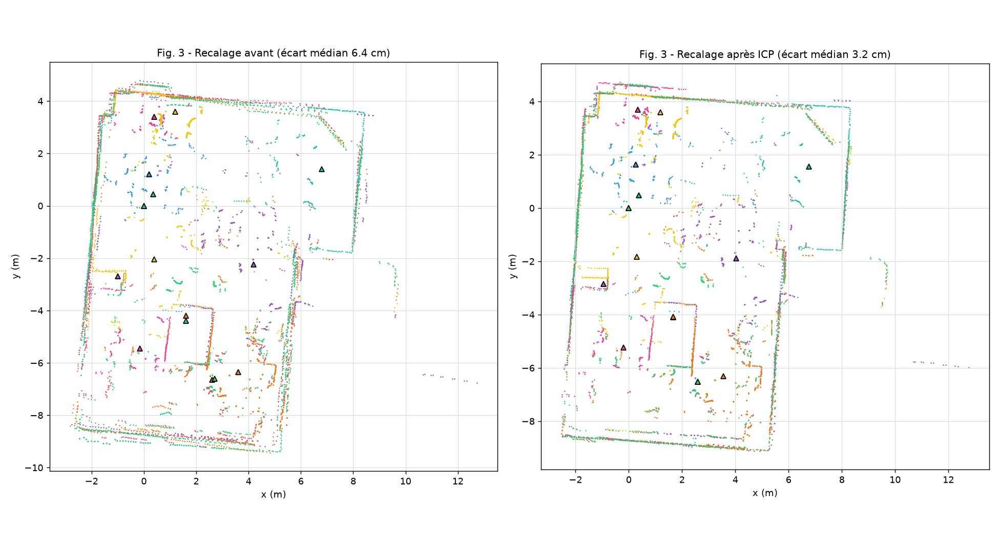
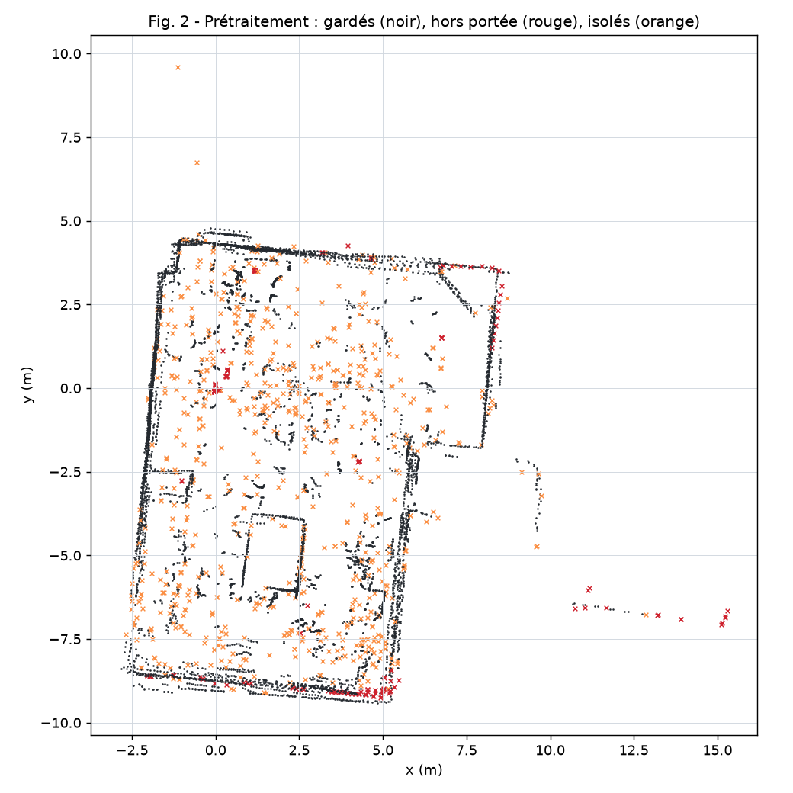
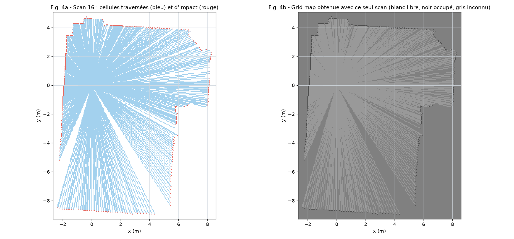
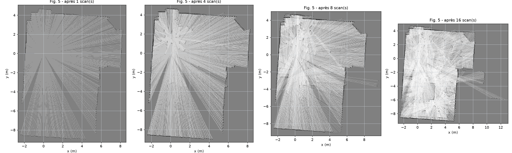
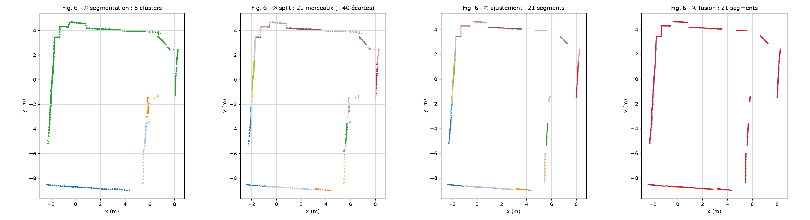
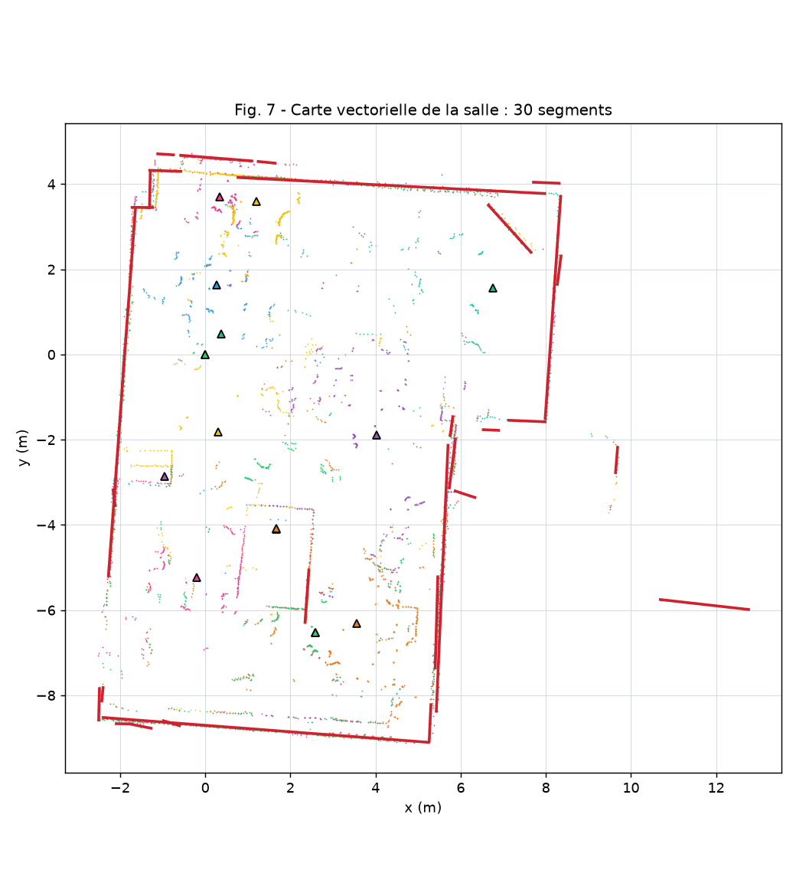
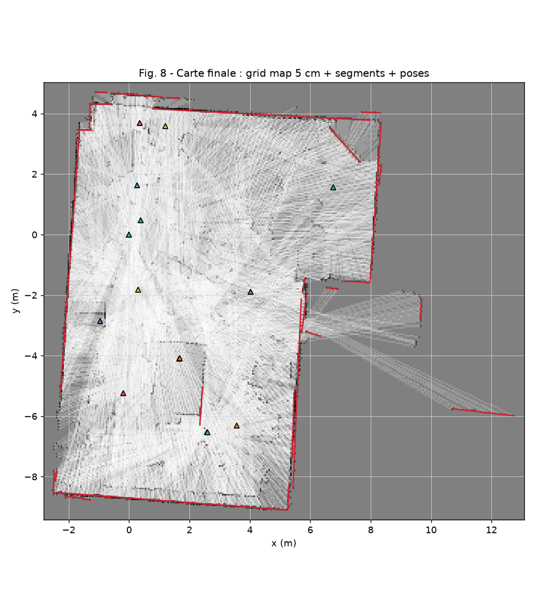
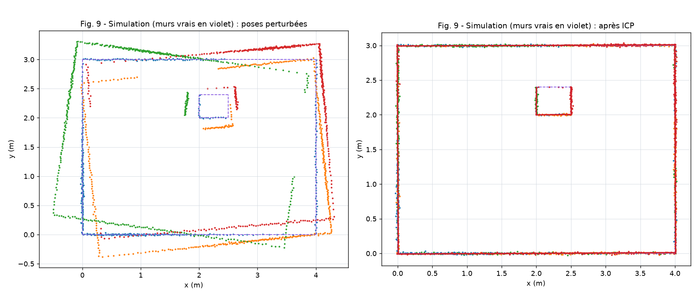

# TP Jour 1 : extraction, visualisation et cartographie

**Données :** 16 scans réels de la salle, acquis le 02/11/2026 avec le robot Mecanum + LD06 + ESP32
(`data/salle/session_salle_2026-11-02.lidar.json`), et des scans simulés à vérité connue.
**Outils :** LidarScope (acquisition en direct), LidarStudio (cartographie pas à pas), modules Python `src/lidar/`.
**Reproduire toutes les figures et tous les chiffres :** `.venv/Scripts/python TP/Jour1/generer_figures.py`

## Synthèse des attendus

| # | Attendu de l'énoncé | Où | État |
|---|---|---|---|
| 1 | Récupérer les données brutes du LD06 | `lecons/01` à `05`, `src/lidar/scope/sources.py`, LidarScope | ✅ |
| 1 | Extraire ses propres scans réels (polaire) | `data/salle/` : 16 scans | ✅ |
| 2 | Afficher plusieurs scans en points cartésiens, couleurs distinctes | LidarScope, LidarStudio étape 1, `lidar.viewer` | ✅ |
| 2 | Modifier la pose de chaque scan indépendamment | LidarStudio étape 3 (flèches + saisie), LidarScope onglet Captures | ✅ (+ recalage automatique ICP) |
| 3 | Scan + pose → carte d'occupation | `gridmap.grid_from_scan`, LidarStudio étape 4 | ✅ |
| 3 | Carte existante + scan + pose → carte mise à jour (traversées + impact) | `gridmap.update_grid`, curseur « pas à pas » de l'étape 4 | ✅ |
| 4 | Nuage de points → segments | `extraction.py` (segmentation, split, ajustement, fusion) | ✅ |
| 4 | Angle, proximité, fusion, intersection, découpe | `segments.py` | ✅ 31 tests |
| 4 | Tolérance numérique + cas limites de la découpe | `segments.EPS = 1e-6 m`, `tests/test_segments.py` | ✅ |
| 5 | Carte vectorielle à partir des fonctions précédentes | `vectormap.py`, LidarStudio étape 5 | ✅ |
| 3-5 | Expliquer démarche, choix, hypothèses, difficultés, limites | ce document | ✅ |
| bonus | Propriétés supplémentaires (pondérations, filtres, durée de vie) | log-odds, confiance des segments, `decay`, filtre de voisinage, nettoyage | ✅ |

---

## 1. Extraction des données lidar

**Démarche.** J'ai d'abord compris le protocole avant d'utiliser la bibliothèque (dossier `lecons/`) :
- trame de 47 octets, en-tête `54 2C`, nombres sur 2 octets en little-endian, CRC8 (polynôme 0x4D) ;
- liaison UART 230 400 bauds en 8N1, soit 10 bits par octet : 375 trames/s occupent 76 % de la ligne ;
- 12 angles par trame, interpolés entre l'angle de début et l'angle de fin ;
- conversion du sens horaire du LD06 vers le sens trigonométrique : `θ = 360 − θ_LD06` ;
- détection d'un nouveau tour au passage 360° → 0° (un tour n'est gardé que s'il couvre plus de 340°).

**Acquisition.** L'ESP32 exécute l'exemple du module, avec `printScanTeleplot`. LidarScope lit le port série,
affiche le scan en direct et capture un scan quand l'image est stable. Une capture est la **médiane de 3 tours**,
pour réduire le bruit.

**Choix techniques.**
- Garder dans la session les **lignes série brutes** de chaque tour, pour pouvoir refaire tout le décodage.
- Format d'échange `.lidar.json` **auto-décrit** : unités, repères, formule de la pose et colonnes sont décrits dans le fichier.

**Difficultés et limites.**
- Le format Teleplot n'envoie que x et y. **L'intensité est perdue** : elle est notée `null` et n'est jamais remplacée par 0.
  Le filtre d'intensité demandé par le cours n'est donc pas applicable à ces scans. Pour l'avoir, il faut
  `ld06.printScanCSV(Serial)`.
- La bibliothèque calcule `y = −d·sin θ`, ce qui donne une carte en miroir. C'est corrigé au décodage.
- À 115 200 bauds en texte, l'ESP32 ne peut pas transmettre tous les tours (il faudrait environ 11 fois plus de débit).
  On reçoit un tour de temps en temps : ce n'est pas gênant si le robot est immobile.
- Le nombre de points par tour varie (environ 325 ou 708 selon les captures) : tours partiels ou doublés côté ESP32.
- Les **poses sont mesurées à la main**, depuis le scan 16 pris comme origine (0, 0, 0). Incertitude estimée :
  environ ±10 cm et ±5°. Le recalage (§2) le confirme : les corrections atteignent 0,44 m et 4°.

## 2. Visualisation des nuages de points

**Outils.**
- **LidarStudio**, étapes 1 à 3 : une couleur par scan, sélection d'un scan, déplacement à la main
  (flèches, pas fin 1 cm / 0,5°, normal ou gros) ou saisie de (x, y, θ).
- **LidarScope** : la même chose, en direct pendant l'acquisition.

**Démarche.** Polaire → cartésien dans le repère du lidar (`x = r cos θ`, `y = r sin θ`), puis repère de la carte :
`P = R(θr)·P_lidar + T(xr, yr)` (`geometry.py`).

**Ajout : recalage automatique (ICP).** Avec les poses mesurées à la main, les murs apparaissent doublés (Fig. 1).
J'ai implémenté un ICP point à point (`matching.py`), qui servira aussi au Jour 2 :
- association de chaque point au point le plus proche ;
- on garde 80 % des paires, les plus proches ;
- rotation et translation optimales par la méthode de Kabsch (SVD) ;
- distance d'association décroissante : 60 → 35 → 20 → 10 cm.

Les scans sont recalés **un par un** sur la carte déjà construite, en partant du scan 16 (l'origine).
Une correction n'est acceptée **que si elle améliore l'accord** avec la carte.

| Mesure | Résultat |
|---|---|
| Validation en simulation (vérité connue, poses faussées de 10 à 25 cm et 5 à 8°) | erreur après ICP ≤ **0,6 cm** et ≤ **0,25°** |
| Écart médian entre scans réels (distance de chaque point au scan voisin) | **6,4 cm → 3,2 cm** |
| Scans nettement améliorés | 1, 2, 8, 9, 13, 14, 15, 17 (ex. scan 9 : 6,8 → 1,4 cm) |
| Scans dégradés | 4 (4,4 → 8,2 cm), 7 (9,5 → 15,6 cm), 10 (9,2 → 10,8 cm) |
| Scan non corrigeable | 3 : seulement 11 % de ses points recouvrent les autres scans |
| Temps de calcul | environ 18 s pour 15 scans (Python, plus proches voisins en force brute) |

**Limites.**
- **Glissement le long d'un mur :** un recalage scan par scan ne voit qu'une partie de la salle. Un long mur droit
  ne contraint pas la position le long de lui-même, et l'ICP peut glisser dans cette direction.
- **Deuxième passage global testé :** chaque scan recalé de nouveau sur tous les autres. Résultat : médiane
  3,2 → 3,4 cm, sans gain, pour 53 s de calcul. Il a été abandonné.
- **Conclusion :** il faut un recalage **global** (graphe de poses, Jour 3) ou des scans qui se recouvrent davantage.
  En salle, il faudrait des positions plus rapprochées.

## 3. Construction d'une grid map 2D

Étapes suivies, d'après le document « Construction d'une grid map 2D à partir d'un scan lidar » :

1. **Grille.**
   - Résolution 5 cm (2 et 10 cm sont disponibles). C'est un compromis : environ 5 fois le bruit du LD06, et des
     cellules assez fines pour les pieds de table. La grille fait 318 × 289 cellules, soit 92 000 cellules pour toute la salle.
   - Valeur de chaque cellule : **log-odds** `L = ln(p/(1−p))`. La mise à jour bayésienne devient une addition.
   - État initial **inconnu** (L = 0) par défaut. Les variantes « libre » (optimiste) et « occupé » (pessimiste) sont proposées.
2. **Points → cellules.** On passe en repère carte avec la pose, puis on calcule `i = ⌊(x − x0)/res⌋` et `j = ⌊(y − y0)/res⌋`.
   - Prétraitement : portée de 0,15 à 10 m.
   - Filtre de **voisinage** : un point qui a moins de 2 voisins dans un rayon de 10 cm + 4 cm par mètre de
     distance est écarté. Le rayon grandit avec la distance parce que les points d'un même mur s'écartent avec la distance.
   - Résultat : 11,6 % des 7 675 points écartés, dont 709 points isolés et 185 hors portée (Fig. 2).
   
3. **Cellules traversées.** Elles sont trouvées avec l'algorithme de **Bresenham** (entier, sans trou), sauf la cellule d'impact.
   On ajoute `logit(p_libre)`, avec p = 0,40.
4. **Cellule d'impact.** On ajoute `logit(p_occ)`, avec p = 0,70.
5. **Mise à jour.** Chaque nouveau scan s'ajoute à la carte existante (Fig. 5).
   - L est borné à ±4, pour qu'un obstacle qui disparaît puisse redevenir libre.
   - Nettoyage optionnel : une cellule occupée sans voisine occupée repasse à « inconnu ».
   - `decay()` : durée de vie des cellules.

**Outils.**
- `gridmap.grid_from_scan` : scan + pose → nouvelle carte.
- `gridmap.update_grid` : carte + scan + pose → nouvelle carte, sans modifier la carte d'entrée.
- LidarStudio, étape 4 : le curseur « scans intégrés » montre la carte après 1, 2, … 16 scans, et les cellules
  traversées (bleu) et d'impact (rouge) du dernier scan.
- Exports : `grid_map_maptool.csv` au format exact de MapTool (1 = occupé), plus `ternaire` (1, 0, −1 = inconnu)
  et `proba` (uint8).

**Difficultés et choix.**
- **Comptage multiple :** une cellule proche du robot est traversée par des dizaines de faisceaux du même scan.
  Si on la comptait à chaque fois, elle deviendrait « certaine » dès le premier scan. Elle n'est donc comptée qu'**une fois par scan**.
- **Impact libéré par un faisceau voisin :** un faisceau rasant peut traverser la cellule d'impact d'un autre
  faisceau et la « libérer ». Une cellule d'impact n'est donc **jamais libérée par le même scan**.

**Limites.**
- La qualité dépend entièrement des poses (cf. §2).
- Les murs fins vus de biais restent peu contrastés, car les nombreux faisceaux qui passent tout près les rendent un peu plus libres.
- Les objets mobiles (personnes) laissent des traces, faute de `decay` appliqué entre les acquisitions.
- La grille ne s'agrandit pas toute seule lors d'une mise à jour.

## 4. Extraction et manipulation de segments

**Nuage → segments** (`extraction.py`, étapes visibles dans LidarStudio et en Fig. 6) :
1. **Segmentation.** Les points sont parcourus dans l'ordre angulaire. Un saut supérieur à `8 cm + 5 % de la distance`
   ouvre un nouveau cluster. On démarre après une rupture, pour ne pas couper un objet à cheval sur 0°.
2. **Split** (Douglas-Peucker). On coupe au point le plus éloigné de la corde tant que l'écart dépasse 4 cm.
3. **Ajustement** par **régression orthogonale** (ACP). Contrairement à `y = ax + b`, elle reste valable pour les murs verticaux.
   Les extrémités sont les projections des points extrêmes.
4. **Fusion** des segments consécutifs « proches ». Les morceaux de moins de 6 points ou de moins de 30 cm sont rejetés.

Sur le scan 16 : 5 clusters, 21 morceaux (+40 trop petits écartés), 21 segments. **La fusion ne regroupe rien ici.**
Les morceaux d'un même mur sont légèrement courbés par le bruit, et leur décalage dépasse la tolérance de 4 cm.
Ce réglage est disponible dans LidarStudio.

**Opérations** (`segments.py`) :

| Fonction | Définition retenue |
|---|---|
| `angle_between` | angle entre les droites support, dans [0°, 90°]. Un segment n'a pas de sens : 1° et 179° font 2°. |
| `are_close` | angle ≤ seuil **et** extrémités du plus court à moins du seuil de la droite du plus long **et** recouvrement ou écart ≤ seuil |
| `merge` | direction moyenne pondérée par les longueurs (angles doublés pour gérer 0°/180°), droite passant par le barycentre, extrémités = projections extrêmes des 4 points |
| `intersection` | forme paramétrique `P1 + t·v1 = P2 + u·v2`, avec t et u dans [0, 1] à la tolérance près. Segments parallèles ou colinéaires : `None` |
| `cut` | voir ci-dessous |

**Découpe : règles de l'énoncé, toutes testées** (`tests/test_segments.py`, 31 tests) :
- intersection obligatoirement sur **les deux** segments ;
- intersection **strictement** à l'intérieur du segment coupé, à plus de EPS de ses extrémités. Sinon, rien ne change ;
- segments colinéaires (ou parallèles) : pas de découpe ;
- on garde le **plus long** côté. Si les longueurs sont égales à EPS près, on garde le côté qui contient **p1**.

La tolérance est `EPS = 1e-6 m`. Elle est bien inférieure au bruit du capteur (environ 1 cm) et bien supérieure
aux erreurs d'arrondi des flottants.

## 5. Construction d'une carte vectorielle

Étapes suivies, d'après le document « Construction d'une carte vectorielle 2D à partir d'un scan lidar »
(`vectormap.py`, LidarStudio étape 5 « Carte ») :

1. **Représentation.** La carte est une liste de *features* : segment + confiance + dernier scan où il a été vu.
   Elle est exportée au format MapTool `x1,y1,x2,y2`.
2. **Prétraitement et passage en repère carte :** comme pour la grid map.
3. **Extraction** des segments du scan (§4).
4. **Association.** Un segment `are_close` d'une feature existante est fusionné avec elle (`merge`) et sa confiance
   augmente. Sinon, il est ajouté.
5. **Absences.**
   - Chaque faisceau robot → impact, raccourci de 10 cm, est un segment de **vide**.
   - Si au moins 3 faisceaux coupent une feature, elle est découpée avec `cut` et sa confiance baisse.
   - Cette étape se fait **avant** l'ajout des nouvelles observations : sinon, un mur revu en partie (porte ouverte)
     serait fusionné puis jamais raccourci.
   - Le test d'intersection est vectorisé (numpy). La carte des 16 scans se construit en **0,6 s**.
6. **Nettoyage :** fusion des features redondantes, suppression des features de confiance nulle ou trop courtes.

| Résultat | Valeur |
|---|---|
| Simulation : écart des extrémités de segments aux vrais murs | médiane **0,6 cm**, max 1,5 cm |
| Salle réelle (16 scans recalés) | **30 segments**, 55 m de murs, le plus long 8,65 m |

**Limites.**
- La découpe « garde le plus long côté » est grossière : une porte ouverte au milieu d'un mur en supprime une moitié,
  alors qu'il faudrait scinder le mur en deux.
- Les meubles donnent beaucoup de petits segments, filtrés par la longueur minimale.
- La carte hérite des erreurs de pose des scans 3, 4, 7 et 10.

## Fichiers produits

- `TP/Jour1/resultats/` : `grid_map_maptool.csv`, `grid_map_ternaire.csv`, `grid_map_proba.csv`,
  `carte_vectorielle.txt`, `metriques.json` (tous les chiffres de ce document).
- `data/salle/session_salle_recalee.lidar.json` : les 16 scans avec les poses corrigées par ICP.
