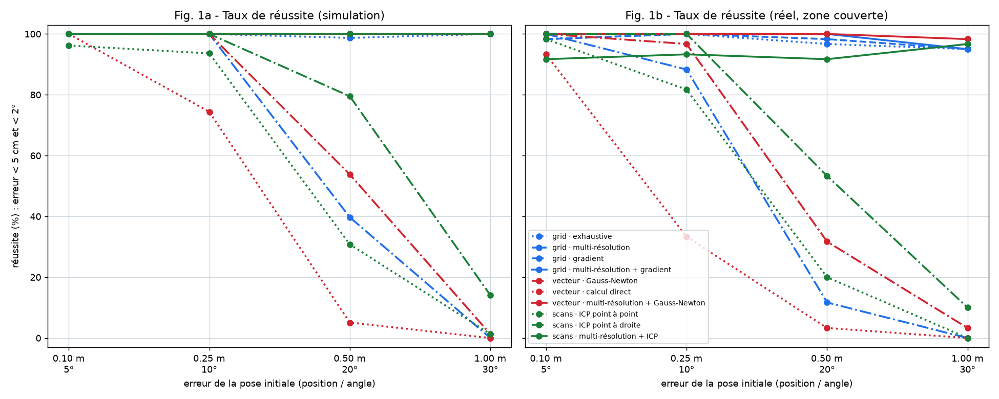
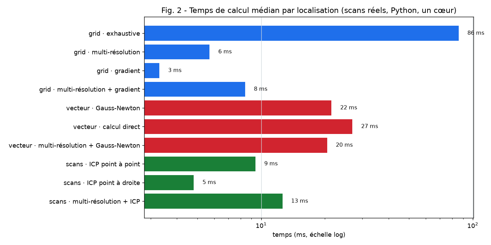
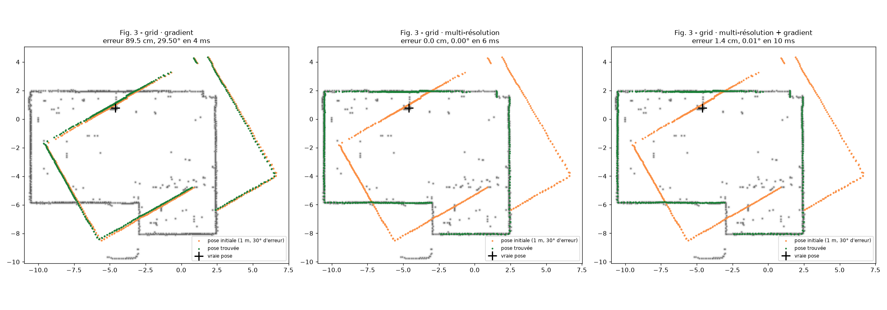

# TP Jour 2 : localisation par scan matching

**Question :** on connaît une référence, un scan et une pose approximative. Il faut retrouver la vraie pose
(x, y, θ) du robot en alignant le scan sur la référence, puis comparer les méthodes avec des chiffres.

- **Données :** 13 scans réels de la salle (`data/salle_jour2/`), dont 9 du 03/11 avec intensité. Leurs poses ont été
  recalées : c'est la référence réelle. On utilise aussi les mêmes 13 poses en **simulation**, où la vérité est exacte.
- **Code :** `src/lidar/localization/` (10 méthodes, 18 tests).
- **Reproduire tous les chiffres et toutes les figures :** `.venv/Scripts/python TP/Jour2/banc_essai.py`
  (6 240 localisations, environ 2 min 40 s).

## Comment ce travail a été fait : hors ligne, à partir des scans déjà enregistrés

La localisation du Jour 2 a été réalisée **en Python, sur le PC, à partir des scans déjà enregistrés en salle**
(ceux qui ont servi à construire la carte). Le robot n'a pas été déplacé de nouveau pour prendre des scans en temps
réel.

**Pourquoi.** Pour mesurer l'erreur d'une méthode, il faut connaître la bonne réponse. Les poses de nos scans
enregistrés sont connues, à 2,4 cm près, grâce au recalage du Jour 1 ; celles d'un nouveau scan ne le seraient pas.
On a donc joué un contrôle où l'on cache la réponse :

1. on prend un scan dont on connaît la pose ;
2. on construit la carte avec **les 12 autres scans seulement**, pour que le scan testé n'aide pas à construire sa
   propre référence ;
3. on fausse volontairement sa pose de départ (de 10 cm / 5° jusqu'à 1 m / 30°) ;
4. on lance la méthode de localisation, puis on compare la pose trouvée à la pose connue.

On recommence pour chaque scan, chaque erreur de départ et chaque méthode, soit 6 240 essais. Le même contrôle est
fait **en simulation**, où la vraie pose est exacte.

**Méthodes utilisées**, celles du cours « Scan matching » :
- recherche exhaustive ;
- multi-résolution ;
- gradient (Gauss-Newton) ;
- calcul direct (Kabsch).

Elles sont appliquées aux trois références : grid map, carte vectorielle, scan voisin. La méthode probabiliste
(filtre de particules) n'a pas été faite.

**Avec le robot en temps réel (fait dans LidarLab, voir § 7).** Le calcul est le même :
1. l'application reçoit chaque tour du lidar (Wi-Fi, câble série ou démo) ;
2. au premier tour, elle cherche dans toute la carte ; ensuite, elle part de la pose du tour précédent ;
3. la position trouvée est affichée en continu, avec le trajet du robot.

Le robot (ESP32, code Arduino) ne calcule rien : il envoie ses points, et tout le calcul est fait en Python sur
le PC.

## Synthèse des attendus

| Attendu de l'énoncé | Réalisation | État |
|---|---|---|
| Une méthode fonctionnelle sur **grid map** | 4 méthodes. La meilleure, multi-résolution + gradient, réussit **99 %** des essais réels en zone couverte | ✅ |
| Une méthode fonctionnelle sur **carte vectorielle** | 3 méthodes. Multi-résolution + Gauss-Newton : **100 %** | ✅ |
| Une méthode fonctionnelle **entre scans** | 3 méthodes. Multi-résolution + ICP : **93 %**, ICP point à droite : **100 %** jusqu'à 25 cm et 10° | ✅ |
| Mêmes scans et mêmes poses initiales pour toutes les méthodes | banc d'essai commun, graine fixe | ✅ |
| Erreur en m et en °, temps, taux de réussite avec seuils explicites | réussite = **erreur < 5 cm et < 2°** | ✅ |
| Sensibilité à l'initialisation | 4 niveaux, de 0,10 m / 5° à 1,00 m / 30°, 6 tirages par niveau | ✅ Fig. 1 |
| Poses connues en simulation | mêmes poses, scans simulés dans la carte de la salle, bruit de 1 cm | ✅ |
| Incertitude des références mesurées | médiane **2,4 cm** (de 1,3 à 21,8 cm selon le scan) | ✅ |

## 1. Les trois références

| Référence | Comment elle est construite pour localiser le scan k | Ce qu'on mesure pour un point |
|---|---|---|
| Grid map | grid map des **12 autres** scans (5 cm, log-odds, Jour 1), transformée en **champ de vraisemblance** | distance au mur (case occupée) le plus proche |
| Carte vectorielle | carte vectorielle des 12 autres scans (Jour 1), 15 à 25 segments | distance au **segment** le plus proche |
| Scan de référence | l'autre scan dont la pose est la plus proche (« pris à proximité ») | distance au point, ou à la droite locale du mur |

C'est un protocole en **laisser-un-dehors** : le scan testé n'a jamais servi à construire sa propre référence.

**Champ de vraisemblance.** La carte est transformée une seule fois. Pour chaque case, on calcule la distance `d`
au mur le plus proche (transformée de distance), puis la valeur `exp(−d²/2σ²)`, avec σ = 5 cm. Un point posé sur un
mur vaut 1, un point loin des murs vaut 0. Le **score** d'une pose est la moyenne de ces valeurs sur les points du
scan : c'est le « nombre de points tombant dans des cellules occupées », adouci, du cours.

## 2. Les méthodes

| Méthode du cours | Mise en œuvre | Référence |
|---|---|---|
| **Recherche exhaustive** | toutes les poses dans ± 1,1 m et ± 35°, au pas de 5 cm (1 case) et 1°, soit 140 000 poses. Astuce : pour un angle donné, décaler d'un nombre entier de cases revient à décaler les indices, ce qui donne toutes les translations d'un coup | grid map |
| **Multi-résolution** | 3 niveaux de carte (cases de 20, 10 puis 5 cm). Recherche complète au niveau grossier (pas de 4°), puis on garde les 4 meilleurs candidats, qu'on affine localement au niveau suivant, et ainsi de suite | grid map, segments rastérisés, scan rastérisé |
| **Gradient (Gauss-Newton)** | on minimise Σ w·d² : linéarisation `d(pose+δ) ≈ d + J·δ`, puis résolution de `(JᵀWJ)·δ = −JᵀW·d`. La distance d'association maximale décroît (50, 25 puis 10 cm), avec une pondération robuste (Cauchy) | grid map (distance interpolée), segments, droites du scan |
| **Calcul direct** | chaque point est apparié à son pied sur le segment le plus proche, puis la rotation et la translation optimales sont calculées en une fois (Kabsch, SVD) ; on répète | segments (ICP point → segment) ; scan (ICP point à point, Jour 1) |
| **Combinaison** | multi-résolution (robuste), puis gradient ou ICP (précis) | les trois |

La méthode probabiliste (filtre de particules) n'a pas été faite. Elle reste un approfondissement possible.

## 3. Résultats

Taux de réussite selon l'erreur de la pose initiale (réussite : erreur < 5 cm et < 2°). L'erreur et le temps sont
des médianes, l'erreur étant calculée sur les essais réussis. Le détail des 6 240 essais est dans
`resultats/essais.csv`.

### Simulation (vérité exacte, 13 scans)

| Méthode | 0,10 m / 5° | 0,25 m / 10° | 0,50 m / 20° | 1,00 m / 30° | Total | Erreur | Temps |
|---|---|---|---|---|---|---|---|
| grid · exhaustive | 100 % | 100 % | 99 % | 100 % | **100 %** | 1,9 cm / 0,00° | 81 ms |
| grid · multi-résolution | 100 % | 100 % | 100 % | 100 % | **100 %** | 1,9 cm / 0,00° | 6 ms |
| grid · gradient | 100 % | 100 % | 40 % | 0 % | **60 %** | 0,4 cm / 0,04° | 3 ms |
| grid · multi-résolution + gradient | 100 % | 100 % | 100 % | 100 % | **100 %** | 0,3 cm / 0,04° | 6 ms |
| vecteur · Gauss-Newton | 100 % | 100 % | 54 % | 1 % | **64 %** | 0,2 cm / 0,04° | 7 ms |
| vecteur · calcul direct | 100 % | 74 % | 5 % | 0 % | **45 %** | 0,8 cm / 0,35° | 18 ms |
| vecteur · multi-résolution + Gauss-Newton | 100 % | 100 % | 100 % | 100 % | **100 %** | 0,2 cm / 0,04° | 10 ms |
| scans · ICP point à point | 96 % | 94 % | 31 % | 1 % | **55 %** | 0,4 cm / 0,12° | 8 ms |
| scans · ICP point à droite | 100 % | 100 % | 80 % | 14 % | **73 %** | 0,1 cm / 0,02° | 3 ms |
| scans · multi-résolution + ICP | 100 % | 100 % | 100 % | 100 % | **100 %** | 0,4 cm / 0,09° | 10 ms |

### Scans réels dans la zone couverte par la carte (10 scans, critère de l'énoncé, voir § 5)

| Méthode | 0,10 m / 5° | 0,25 m / 10° | 0,50 m / 20° | 1,00 m / 30° | Total | Erreur | Temps |
|---|---|---|---|---|---|---|---|
| grid · exhaustive | 98 % | 100 % | 97 % | 95 % | **98 %** | 2,1 cm / 0,00° | 86 ms |
| grid · multi-résolution | 98 % | 100 % | 98 % | 95 % | **98 %** | 2,1 cm / 0,00° | 6 ms |
| grid · gradient | 100 % | 88 % | 12 % | 0 % | **50 %** | 0,8 cm / 0,09° | 3 ms |
| **grid · multi-résolution + gradient** | 100 % | 100 % | 100 % | 95 % | **99 %** | **0,8 cm / 0,09°** | **8 ms** |
| vecteur · Gauss-Newton | 100 % | 97 % | 32 % | 3 % | **58 %** | 1,6 cm / 0,21° | 22 ms |
| vecteur · calcul direct | 93 % | 33 % | 3 % | 0 % | **32 %** | 2,8 cm / 0,72° | 27 ms |
| vecteur · multi-résolution + Gauss-Newton | 100 % | 100 % | 100 % | 98 % | **100 %** | 1,4 cm / 0,21° | 20 ms |
| scans · ICP point à point | 98 % | 82 % | 20 % | 0 % | **50 %** | 0,9 cm / 0,17° | 9 ms |
| scans · ICP point à droite | 100 % | 100 % | 53 % | 10 % | **66 %** | 0,8 cm / 0,06° | 5 ms |
| scans · multi-résolution + ICP | 92 % | 93 % | 92 % | 97 % | **93 %** | 1,0 cm / 0,15° | 13 ms |

### Scans réels, tous (13 scans, y compris hors zone couverte)

| Méthode | 0,10 m / 5° | 0,25 m / 10° | 0,50 m / 20° | 1,00 m / 30° | Total |
|---|---|---|---|---|---|
| grid · multi-résolution + gradient | 81 % | 78 % | 77 % | 74 % | **78 %** |
| vecteur · multi-résolution + Gauss-Newton | 77 % | 77 % | 77 % | 76 % | **77 %** |
| scans · ICP point à droite | 100 % | 96 % | 46 % | 8 % | **62 %** |

Les 10 méthodes sur les 13 scans : `resultats/tableau.md`.

## 4. Analyse

**Gradient seul : précis mais myope.** Gauss-Newton et l'ICP donnent les erreurs les plus faibles : 0,1 à 0,8 cm en
simulation, environ 1 cm en réel. Ils réussissent tant que la pose initiale est à moins de 25 cm et 10°, mais tombent
à 0-14 % à 1 m et 30°. Ils suivent la pente du score à partir de la pose initiale. Si un autre mur est plus proche que
le bon, ils s'y accrochent : c'est le **minimum local** du cours (Fig. 3, à gauche : 90 cm d'erreur).

**Recherche exhaustive : robuste mais grossière et lente.** Elle ne dépend pas de la pose initiale : de 95 à 100 %
quel que soit le niveau. Mais elle ne peut pas faire mieux que son pas, d'où une erreur médiane de 2 cm. Et elle teste
140 000 poses, ce qui prend 80 à 90 ms.

**Multi-résolution : la même robustesse, 14 fois plus vite.** Elle donne le même résultat que l'exhaustive (98 %)
en 6 ms. La carte grossière lisse les détails, ce qui évite les minima locaux, et les niveaux fins n'explorent
qu'autour des bons candidats.

**Combinaison : le meilleur des deux.** La multi-résolution suivie du gradient obtient **99 % en réel (100 % en
simulation), 0,8 cm et 0,09°, en 8 ms**. C'est la méthode que je retiens pour la suite (localisation du robot,
puis SLAM).

**Comparaison des références.**
- **Grid map :** la plus simple et la plus robuste.
- **Carte vectorielle :** la plus précise en simulation (0,2 cm), parce qu'un segment n'a pas de résolution. Elle
  est un peu moins précise en réel (1,4 cm), car les segments réels sont imparfaits (meubles, murs coupés).
- **Calcul direct point → segment :** le moins robuste (32 %). Un point peut être apparié au mauvais segment
  (coin, mur voisin parallèle), et le calcul direct suit aveuglément ces paires.
- **ICP point à droite :** plus robuste que l'ICP point à point (66 % contre 50 % en réel) et 2 fois plus rapide,
  parce qu'un point peut glisser le long du mur sans pénalité.

## 5. Incertitude des références réelles et zone couverte

- **La « vraie » pose réelle est elle-même une estimation :** c'est la pose recalée. Son incertitude est estimée par
  l'écart médian entre chaque scan et les 12 autres : **2,4 cm** en médiane, de 1,3 à 21,8 cm. Une erreur réelle de
  1 cm n'est donc pas significative.
- **Scan 2 :** sa référence est douteuse (écart de 21,8 cm). Pour la grid map, il est mieux placé 51 cm plus loin
  (score 0,52 contre 0,19 à la pose de référence).
- **Zone couverte (condition de l'énoncé) :** à sa vraie pose, au moins **35 %** des points du scan doivent être à
  moins de 10 cm d'un mur de la carte des 12 autres. Couverture par scan :

| Scan | 1 | 2 | 3 | 4 | 5 | 6 | 7 | 8 | 9 | 10 | 11 | 12 | 13 |
|---|---|---|---|---|---|---|---|---|---|---|---|---|---|
| Couverture | 26 % | 22 % | 39 % | 39 % | 17 % | 100 % | 54 % | 69 % | 100 % | 66 % | 89 % | 91 % | 100 % |

**Les scans 1, 2 et 5 sont hors zone couverte :** ils voient surtout des parties de la salle qu'aucun autre scan ne
voit. Sur ces scans, les recherches globales trouvent une autre position, décalée de 0,5 à 1,3 m le long des grands
murs. C'est l'**ambiguïté des environnements répétitifs** citée dans le cours. Les résultats sur tous les scans sont
donnés quand même : c'est là que les taux plafonnent vers 77 %.

## 6. Limites et suite

- **Temps de calcul :** mesuré en Python sur un seul cœur. Sur l'ESP32, seul le gradient (3 à 8 ms ici) serait
  envisageable.
- **Simulation optimiste :** la salle simulée ne contient que les segments de la carte, sans meubles. Elle est donc
  plus facile que la réalité (100 % contre 99 %).
- **Méthodes non testées :** pas de méthode probabiliste, et pas de méthode par moments géométriques (vecteur
  résultant).
- **Suite (Jour 3) :**
  - localiser le robot pendant qu'il roule : prédiction par la commande, puis correction par
    « multi-résolution + gradient » ;
  - en faire un SLAM qui agrandit la carte au fur et à mesure.

## 7. Ajout : localisation globale et en temps réel (dans LidarLab)

Les méthodes ci-dessus cherchent **autour d'une pose de départ**. Pour l'usage voulu par le TP, il faut aussi
pouvoir retrouver un scan **sans pose de départ**, puis suivre le robot qui bouge :
- on a une carte de référence, figée ;
- on y replace des scans de la liste ou importés ;
- on y suit le robot en direct.

| Ajout | Principe | Résultat |
|---|---|---|
| Carte de référence validée (`refmap.py`) | la grid map et les murs, retouches à la main comprises, figés et enregistrés dans le projet | même carte pour toutes les localisations |
| Localisation globale (`localization/globalloc.py`) | positions = cases libres tous les 20 cm, orientations tirées de la direction des murs, score sur un champ lissé, 6 meilleures poses affinées, confiance par les points qui départagent les deux meilleures. Idée reprise de l'appli ld06-slam d'un camarade, réécrite en Python | **10 scans réels sur 13 replacés à moins de 1,2 cm**, en 0,7 s. Les 3 autres voient surtout des meubles (21 à 30 % de points sur les murs) : ils sont signalés « ambiguë » ou « faible » au lieu de recevoir une pose fausse |
| Suivi en temps réel (`localization/tracking.py`) | 1er tour en global, puis recherche autour de la pose précédente (± 60 cm, ± 20°), et retour en global si moins de 35 % des points sont sur les murs | démo dans la carte : erreur médiane 2,1 cm. Robot Wi-Fi simulé et piloté (protocole RobotControl) : **1,1 cm**, ≈ 15 ms par tour |
| Démonstration dans LidarLab | la carte validée reste fixe ; un scan (de la liste ou importé) est déplacé et tourné à la souris n'importe où, puis « Localiser » le ramène sur la carte (méthode choisie depuis la pose laissée + recherche globale, on garde la meilleure) | scans réels traînés de 3 m et tournés : **10/13 ramenés à ≤ 1,2 cm** |
| Robot en Wi-Fi (`robot.py`) | lecture de `/scan` (binaire) et commandes `/forward?time=…`, comme RobotControl | testé contre un faux robot HTTP ; **reste à tester avec le vrai robot** |

## Fichiers produits

- `resultats/essais.csv` : les 6 240 localisations, une ligne chacune (jeu, scan, couverture, niveau, méthode,
  erreurs, temps, score, réussite).
- `resultats/synthese.json` : protocole et résultats par méthode.
- `resultats/tableau.md` : les tableaux des 10 méthodes.
- `resultats/console.txt` : la sortie du dernier lancement.
- `figures/` : les figures 1 à 3.
